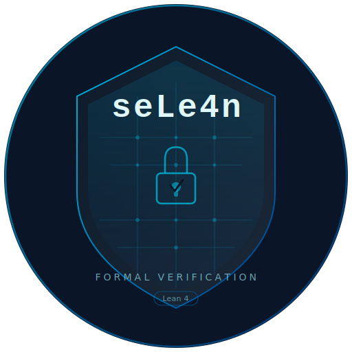

<p align="center">
  <picture>
    <source media="(prefers-color-scheme: dark)" srcset="../../../assets/logo_dark.png" />
    
  </picture>
</p>

<p align="center">
  <a href="https://github.com/hatter6822/seLe4n/actions/workflows/lean_action_ci.yml"></a>
  <a href="https://github.com/hatter6822/seLe4n/actions/workflows/platform_security_baseline.yml"></a>
  
  
  <a href="../../../LICENSE"></a>
</p>

<p align="center">
  一个使用 Lean 4 编写并附带机器验证证明的微内核，受
  <a href="https://sel4.systems">seL4</a> 架构启发。首个硬件目标平台：
  <strong>Raspberry Pi 5</strong>。
</p>
<p align="center">
  <div align="center">
    在以下工具的协助下精心打造：
  </div>
  <div align="center">
    claude :robot: :heart: :robot: codex
  </div>
  <div align="center">
    <strong>请据此理解本内核的性质</strong>
  </div>
</p>

<p align="center">
  <a href="../../../README.md">English</a> ·
  **简体中文** ·
  <a href="../es/README.md">Español</a> ·
  <a href="../ja/README.md">日本語</a> ·
  <a href="../ko/README.md">한국어</a> ·
  <a href="../ar/README.md">العربية</a> ·
  <a href="../fr/README.md">Français</a> ·
  <a href="../pt-BR/README.md">Português</a> ·
  <a href="../ru/README.md">Русский</a> ·
  <a href="../de/README.md">Deutsch</a> ·
  <a href="../hi/README.md">हिन्दी</a> ·
  <a href="../uk/README.md">Українська</a>
</p>

---

## 什么是 seLe4n？

seLe4n 是一个用 Lean 4 从零构建的微内核。每个内核转换都是可执行的纯函数，每个
不变量都由 Lean 内核检查：生产证明面中没有任何 `sorry` 或 `axiom`。同一份 Lean
代码被编译为本机代码，并与一个小型 Rust 硬件层一起链接成在目标平台上启动的内核
镜像。

本项目保留 seL4 基于能力（capability）的安全模型，并越来越多地保留 seL4 面向用
户的 ABI，同时用 Lean 证明更多性质，并在 seL4 留有空隙之处加以加固。完整规范见
[`docs/spec/SELE4N_SPEC.md`](../../../docs/spec/SELE4N_SPEC.md)；以下各项是进入规范的
入口。

### seL4 的 ABI

- **seL4-MCS 的系统调用** — MCS 的 11 个系统调用（`Call` … `Yield`），在 `x7`
  中按 seL4 的编号放置；操作由系统调用、被调用能力的类型和消息标签共同选择
  （`Syscall.selectOperation`），与 seL4 相同
- **seL4 的错误与故障载荷** — `LookupFault`、按 seL4 消息寄存器顺序排列的错误
  帧、接收端的能力故障、`Restart` 状态、作为额外能力传递的能力参数，以及保存在
  能力中的守卫和唯一的 `resolveAddressBits`
- seL4 ABI 的其余工作（其余调用、超时故障、按调用划分的权限、每核 Running 状态）
  属于进行中的工作流 WS-SX；其各行见
  [`docs/planning/SEL4_ABI_FIDELITY_PLAN.md`](../../../docs/planning/SEL4_ABI_FIDELITY_PLAN.md)

### 调度与实时

- **作为能力的调度上下文** — CPU 时间是内核对象。`SchedContext` 持有 seL4-MCS
  的预算、周期和补充（refill），通过核心的 `SchedControl` 权限配置，并通过能力
  绑定到线程；其不变量（`budgetWithinBounds`、`refillsConserved`）属于顶层不变量
  束。带宽隔离由 `refill_window_bound` 给出：上下文在任意一个周期长的窗口内运行
  时间都不超过其预算，即 seL4-MCS 的滑动窗口保证。带 EDF 根的分层恒定带宽调度
  器补上反方向的保证（被接纳的服务器在每个窗口都能得到其预算），是计划中的工作
  流 WS-CB（[`docs/planning/HIERARCHICAL_CBS_PLAN.md`](../../../docs/planning/HIERARCHICAL_CBS_PLAN.md)）
- **被动服务器** — 服务器在 IPC 期间使用客户端捐赠的调度上下文运行；
  `donationChainAcyclic` 排除循环捐赠
- **预算驱动的 IPC 超时** — 预算耗尽的阻塞线程会被移出其端点队列
  （`timeoutThread`）
- **优先级继承** — 传递式传播，经机器检查无阻塞环（`blockingAcyclic`），并有有
  界反转定理（`pip_bounded_inversion`）
- **有界延迟** — 最坏响应时间的参数化上界
  `wcrtBound D L_max N B P = D × L_max + N × (B + P)`
  （`bounded_scheduling_latency_exists`，另有每核形式），在
  `SeLe4n/Kernel/Scheduler/Liveness/` 的模块上得到证明

### 内核对象与内存

- **从 untyped 内存切分出的对象** — retype 从 untyped 能力的区域中切分出对象，
  untyped 的重置与 seL4 相同。把每个切分对象的单元移入其 untyped 自身内存，是进
  行中的工作流 WS-UC
- **内核入口不分配任何内存** — 编译后的系统调用、故障和中断入口不做任何堆分配；
  retype 的切分只分配新对象自身的单元。QEMU 堆门禁
  （`scripts/test_qemu_heap_allocations_per_syscall.sh`）在启动后的镜像上测量每
  个入口，任何其他计数都会失败
- **数据结构** — 对象存储和 VSpace 映射是经过验证的 Robin Hood 哈希表
  （`RHTable`，带 `distCorrect`、`noDupKeys` 和 `probeChainDominant`）；CNode 与
  seL4 一样是 `2^radix` 个槽位的扁平数组；运行队列、端点与通知队列以及应答等待
  者都通过 TCB 链接，每个都有一个幽灵抽象队列，并已证明链接与之一致
- **通过槽位链接的能力派生树** — 每个槽位保存其父、首子和兄弟链接（seL4 的映射
  数据库），并已证明与树一致；删除、撤销（seL4 的 `cteRevoke` 循环）和槽位转移都
  沿链接进行
- **VSpace** — ARMv8 页表，按帧强制 W^X，并以内存类型检查拒绝 RAM 的非缓存别名

### 安全与验证

- **N 域信息流** — 推广 seL4 两域划分的参数化流策略；长度由
  `enforcementBoundaryExtended_count`（每核边界由
  `enforcementBoundaryPerCore_count`）固定的强制边界；`NonInterferenceStep` 每个
  构造子各有一条非干扰定理；以及通过 `auditTrail` 能力读取的、有界且失败即关闭
  的解密审计记录
- **组合证明层** — `proofLayerInvariantBundle`
  （`SeLe4n/Kernel/Architecture/Invariant.lean`）把每个子系统的不变量束（调度器、
  能力、IPC 及其与调度器的耦合、生命周期、服务注册表、VSpace、跨子系统、TLB 与
  指令缓存一致性、TLB 击落、解密审计日志，以及每个链接结构与其幽灵的一致性）合
  并为一个义务，从启动起贯穿每个操作
- **多核** — 四个核心，支持每核调度、跨核 IPC 与唤醒以及 TLB 击落；SMP 完成工作
  流（WS-SM）正在进行
- **三阶段状态** — 带不变量见证的构建阶段冻结为不可变表示，并证明查找等价；冻结
  操作覆盖 `frozenOpCoverage` 列出的系统调用，由 `frozenOpCoverage_count` 固定
- **服务注册表** — seLe4n 的扩展，seL4 中没有：服务通过 `serviceRegistry` 能力
  注册和查找，并记录在提供服务的端点上；依赖策略与 seL4 一样交给用户态服务管理器

## 当前状态

<!-- Metrics below are synced from docs/codebase_map.json → readme_sync section.
     Regenerate with: ./scripts/generate_codebase_map.py --pretty
     Source of truth: docs/codebase_map.json (readme_sync) -->

| 属性 | 值 |
|------|-----|
| **版本** | `0.37.35` |
| **Lean 工具链** | `v4.28.0` |
| **生产代码行数** | 663,097 行，分布于 655 个文件 |
| **测试代码行数** | 92,061 行，分布于 71 个测试套件 |
| **已证明的声明** | 25,286 个定理/引理声明（零 sorry/axiom） |
| **Rust crate** | `sele4n-types`、`sele4n-abi`、`sele4n-sys`（用户态封装）、`sele4n-hal`（内核硬件层），以及主机测试 `sele4n-lean-boundary` |
| **目标硬件** | Raspberry Pi 5 (BCM2712 / ARM Cortex-A76 / ARMv8-A) |
| **启动通道** | 每条 QEMU 通道先在 [rpi5_machine](https://github.com/hatter6822/rpi5_machine) 的 `raspi5b` 机器上启动 Raspberry Pi 5 镜像，再在 QEMU 的 `virt` 上启动 `virt` 镜像 |
| **工作流** | 每个未关闭工作流的状态：[`docs/agent_guide/WORKSTREAM_CONTEXT.md`](../../../docs/agent_guide/WORKSTREAM_CONTEXT.md)；索引与债务登记：[`docs/REGISTERED_DEBT.md`](../../../docs/REGISTERED_DEBT.md) |
| **审计** | [`docs/audits/`](../../../docs/audits/README.md) — 当前审计的产物；更早的审计已归档 |
| **代码库地图** | [`docs/codebase_map.json`](../../../docs/codebase_map.json) — 机器可读的声明清单 |

指标由 `./scripts/generate_codebase_map.py` 从代码导出，保存在
[`docs/codebase_map.json`](../../../docs/codebase_map.json) 的 `readme_sync` 键下。请用
`./scripts/sync_documentation_metrics.sh`（仅校验：`--check`）一并更新全部文档。

## 快速开始

```bash
./scripts/setup_lean_env.sh    # install the Lean toolchain and test dependencies
source ~/.elan/env
lake build                     # build the default targets
lake exe sele4n                # run the trace harness
./scripts/test_smoke.sh        # hygiene + build + trace + negative-state
```

`lake build` 只构建 `Main.lean` 和测试可执行文件可达的内容；提交 `.lean` 文件前，
请按名称构建其模块（`lake build <Module.Path>`）。完整流程见
[`docs/DEVELOPMENT.md`](../../../docs/DEVELOPMENT.md)，所有贡献者遵循的规则见
[`CLAUDE.md`](../../../CLAUDE.md)。

## 文档

| 从这里开始 | 然后 |
|------------|------|
| [`docs/DEVELOPMENT.md`](../../../docs/DEVELOPMENT.md) — 流程、验证、PR 清单 | [`docs/spec/SELE4N_SPEC.md`](../../../docs/spec/SELE4N_SPEC.md) — 规范与里程碑 |
| [`docs/gitbook/README.md`](../../../docs/gitbook/README.md) — 完整手册 | [`docs/spec/SEL4_SPEC.md`](../../../docs/spec/SEL4_SPEC.md) — seL4 参考语义 |
| [`docs/codebase_map.json`](../../../docs/codebase_map.json) — 机器可读清单 | [`docs/REGISTERED_DEBT.md`](../../../docs/REGISTERED_DEBT.md) — 每个延后事项及其负责人 |
| [`CONTRIBUTING.md`](../../../CONTRIBUTING.md) — 贡献流程 | [`CHANGELOG.md`](../../../CHANGELOG.md) — 版本历史 |

## 验证命令

```bash
./scripts/test_fast.sh      # Tier 0+1: hygiene + build
./scripts/test_smoke.sh     # + Tier 2: trace + negative-state
./scripts/test_full.sh      # + Tier 3: invariant surface anchors + Lean #check
NIGHTLY_ENABLE_EXPERIMENTAL=1 ./scripts/test_nightly.sh  # + Tier 4: nightly determinism

./scripts/test_rust.sh                 # host Rust: build, tests, fmt, clippy
./scripts/test_aarch64_cross_build.sh  # the kernel HAL's real target

./scripts/test_qemu.sh                 # boot the image on raspi5b, then on virt
./scripts/test_qemu.sh --lean-kernel   # the Lean-linked images, on four cores
```

任何 PR 之前至少运行 `test_smoke.sh`；修改定理、不变量或 Tier 3 锚点时运行
`test_full.sh`。每一层在第一个失败的检查处停止；传入 `--continue` 可一次收集全部
失败。

修改 `rust/` 下任何内容后，请运行 **两条** Rust 通道。它们覆盖同一 crate 互不相
交的两半：在主机上，每个 `#[cfg(target_arch = "aarch64")]` 块在 rustc 或 clippy
看到之前就被移除，因此主机通道看不到构成 HAL 大部分的条件块、`asm!` 位置和 `.S`
源文件。交叉通道以两种配置为 `aarch64-unknown-none-softfloat` 构建 `sele4n-hal`，
确认汇编源文件确实被汇编，对交叉目标运行 lint，并反汇编 release 目标文件以证明其
不使用任何 FP/SIMD 寄存器。QEMU 通道首次使用时会按 `scripts/setup_rpi5_machine.sh`
中固定的提交构建 rpi5_machine；缺少前提条件的通道报告 NOT RUN，而不是通过。完整
列表见 [`docs/DEVELOPMENT.md`](../../../docs/DEVELOPMENT.md)。

## 架构

seLe4n 由分层契约组成，每层都有可执行的转换和经机器检查的不变量保持证明：

```
┌──────────────────────────────────────────────────────────────────────┐
│   Kernel entries  (syscall, fault, interrupt, per-core timer tick)   │
│                 Kernel API  (SeLe4n/Kernel/API.lean)                 │
├──────────────┬─────────────┬────────────┬───────────┬────────────────┤
│  Scheduler   │  Capability │    IPC     │ Lifecycle │  Service (ext) │
│   RunQueue   │  CSpace/CDT │  DualQueue │  Untyped  │    Registry    │
│ SchedContext │             │  Donation  │  Retype   │                │
├──────────────┴─────────────┴────────────┴───────────┴────────────────┤
│         Information Flow  (Policy, Projection, Enforcement)          │
├──────────────────────────────────────────────────────────────────────┤
│  Architecture  (VSpace, page tables, TLB/cache, decode, trap frame)  │
├──────────────────────────────────────────────────────────────────────┤
│         Concurrency  (locks, memory model, per-core state)           │
├──────────────────────────────────────────────────────────────────────┤
│                     Model  (Object, State, CDT)                      │
├──────────────────────────────────────────────────────────────────────┤
│             Foundations  (Prelude, Machine, MachineConfig)           │
├──────────────────────────────────────────────────────────────────────┤
│    Platform  (Contract, Boot, Sim, RPi5, QemuVirt)  ← bindings       │
├──────────────────────────────────────────────────────────────────────┤
│        Rust HAL  (rust/sele4n-hal: boot, traps, GIC, MMU, SMP)       │
└──────────────────────────────────────────────────────────────────────┘
```

## 源码结构

```
SeLe4n/
├── Prelude.lean                 Typed identifiers, KernelM monad
├── Machine.lean                 Register file, memory, timer
├── Model/                       Object types, SystemState, slot links, builder/freeze phases
├── Kernel/
│   ├── API.lean                 Unified public API + apiInvariantBundle
│   ├── *Entry.lean              Compiled syscall, fault, interrupt and per-core timer entries
│   ├── Scheduler/               Run queues, selection, priority inheritance, liveness (WCRT)
│   ├── SchedContext/            Scheduling contexts, seL4-MCS refills, SchedControl
│   ├── Capability/              CSpace operations, derivation tree, authority proofs
│   ├── IPC/                     Dual-queue endpoints, donation, timeouts, cross-core IPC
│   ├── Lifecycle/               Untyped retype and reset, thread suspend/resume
│   ├── Service/                 Service registry and its invariants
│   ├── Architecture/            VSpace (W^X), page tables, TLB/cache models, decode, trap frame
│   ├── InformationFlow/         N-domain policy, projection, enforcement, NI proofs
│   ├── Concurrency/             Lock model, memory model, per-core runtime
│   ├── RobinHood/               Verified Robin Hood hash table (RHTable/RHSet)
│   ├── RadixTree/               CNode radix view and its bridge to the slot array
│   ├── FrozenOps/               Frozen-state operations + commutativity proofs
│   └── CrossSubsystem.lean      Cross-subsystem invariant composition
├── Platform/
│   ├── Contract.lean            PlatformBinding typeclass and boundary contracts
│   ├── Boot.lean, Boot/         Boot sequence: root server, initial threads, IRQ nodes
│   ├── FFI.lean                 The Lean side of the HAL boundary
│   ├── Sim/                     Simulation platform (permissive contracts for testing)
│   ├── RPi5/                    Raspberry Pi 5 (BCM2712, GIC-400, MMIO, boot VSpace)
│   └── QemuVirt/                QEMU `virt` binding and boot entry
├── Testing/                     Test harness, state builder, invariant checks, censuses
Main.lean                        Executable entry point
tests/                           Executable test suites + fixtures
rust/                            sele4n-types, sele4n-abi, sele4n-sys, sele4n-hal, sele4n-lean-boundary
```

每个子系统遵循 **Operations/Invariant 分离**：转换在 `Operations.lean`，证明在
`Invariant.lean`。统一的 `apiInvariantBundle` 把所有子系统不变量汇集为一个证明义
务。子系统地图见 [`docs/DEVELOPMENT.md`](../../../docs/DEVELOPMENT.md) §5；按文件的完整
清单见 [`docs/codebase_map.json`](../../../docs/codebase_map.json)。

## 与 seL4 的比较

| 特性 | seL4 | seLe4n |
|------|------|--------|
| **系统调用 ABI** | MCS 系统调用、调用标签、错误与故障载荷 | 相同：seL4-MCS 的 11 个系统调用及其编号、按标签选择的调用和 seL4 的错误载荷；其余调用是 WS-SX 的行 |
| **调度** | 带零星服务器补充的 MCS 调度上下文 | 相同的补充机制，并已证明守恒不变量和每窗口一个预算的上界（`refill_window_bound`）；计划提供带 EDF 根的分层 CBS（WS-CB） |
| **被动服务器** | SchedContext 捐赠 | 带 `donationChainAcyclic` 不变量的已验证捐赠 |
| **IPC** | 每个端点一条队列，经 TCB 链接 | 每个端点一条发送队列和一条接收队列，均经 TCB 链接，可在任意位置 O(1) 移除；预算驱动的超时 |
| **信息流** | 二元 high/low 划分 | 可配置的 N 域策略、由 `enforcementBoundaryExtended_count` 固定的强制边界、每步一条非干扰定理，以及对每次授权解密的能力控制审计记录 |
| **优先级继承** | 不在内核中 | 经机器检查的传递式 PIP，无阻塞环，并有有界反转定理 |
| **有界延迟** | 无形式化 WCRT 上界 | `wcrtBound D L_max N B P = D × L_max + N × (B + P)`，在活性模块上证明 |
| **对象存储** | 位于物理地址的对象 | 已验证的 Robin Hood 哈希表（`RHTable`/`RHSet`）；CNode 与 seL4 一样是扁平槽位数组 |
| **内存映射** | 内核不强制 W^X | 按帧强制 W^X 作为不变量；内存类型检查拒绝 RAM 的非缓存别名 |
| **服务管理** | 不在内核中 | 端点上由能力控制的服务注册表；依赖策略在用户态 |
| **证明** | Isabelle/HOL，经精化覆盖 C 代码 | Lean 4，与可执行转换放在一起；零 sorry/axiom（数量见上表） |
| **平台** | C 级 HAL | 带类型化边界契约的 `PlatformBinding` 类型类和 Rust HAL |

## 许可证与第三方署名

seLe4n 本身采用 GNU General Public License v3.0 或更高版本（GPLv3+）授权；完整文本见 [`LICENSE`](../../../LICENSE)。第三方构建依赖（`cc`、`find-msvc-tools`、`shlex`，均为 `MIT OR Apache-2.0` 双重许可）按 MIT 选项使用；其上游版权声明和许可声明原文收录于 [`THIRD_PARTY_LICENSES.md`](../../../THIRD_PARTY_LICENSES.md)。内核二进制文件中不包含任何运行时链接的第三方代码——HAL 为 `#![no_std]`，仅使用 `core::*`。

---

本文档翻译自 [English README](../../../README.md)。
